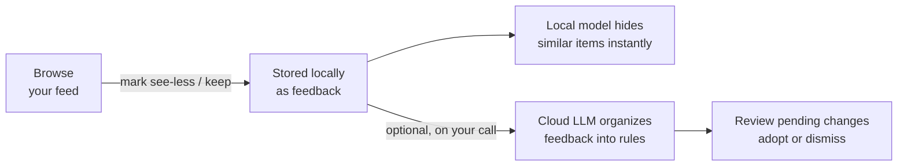
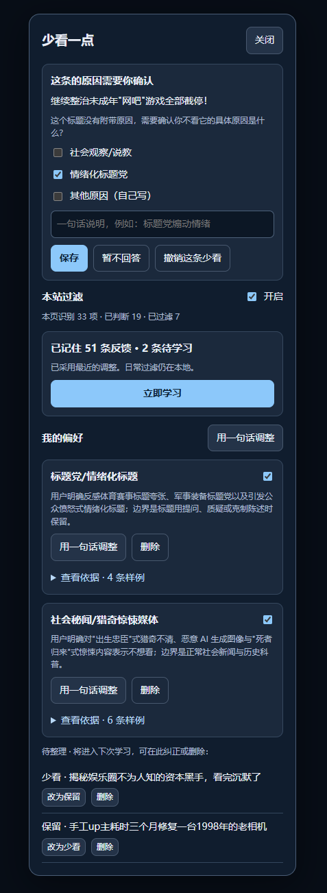
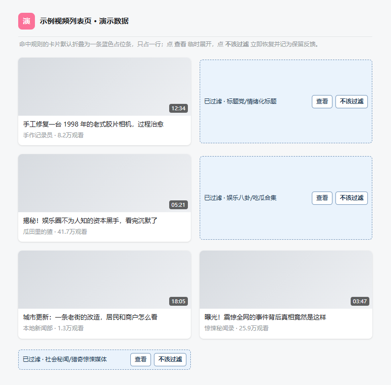

<div align="center">


# Watch Less · 少看一点

**A semantic feed filter that runs entirely in your browser.**

Mark what you don't want to see — a small local model learns from your marks and hides similar content. Optional cloud refinement turns your feedback into named rules.

[](semantic-page-filter.user.js)
[](LICENSE)
[](https://www.tampermonkey.net/)

**English** · [简体中文](README.zh-CN.md)

</div>

---

## Why

Feeds keep showing things you don't care about: clickbait, rage bait, drama compilations. Keyword blocklists can't catch "same kind of thing, different words", and shipping your browsing history to a cloud AI is a trade you may not want to make.

Watch Less takes a middle path:

- A **small multilingual semantic model runs inside your browser** (WebAssembly, ~118 MB, downloaded once per site). Your daily filtering never leaves your machine.
- You teach it by **marking items**, not by writing regex. Two clicks on a card, and similar titles get folded away.
- When you want more structured rules, an **optional** cloud LLM step organizes your feedback into named rules — you review every change before it takes effect. No backend of your own to run.

## How it works



1. **Browse as usual.** Items matching your feedback get folded into a one-line placeholder with *View* and *Shouldn't be filtered* buttons — one click restores the card and records a keep-vote.
2. **Mark what annoys you.** *See less like this* on any card. No forms required. Wrong click? Undo it within seconds, or later from the panel.
3. **Optionally refine.** When enough new feedback piles up (default: 10), the script can ask your LLM to group it into rules like *标题党/情绪化标题* (clickbait/emotional headlines) with clear boundaries. **Nothing takes effect until you adopt it.**

<div align="center">
<table>
<tr>
<td width="40%"></td>
<td width="60%"></td>
</tr>
</table>
<sub>Left: the panel — answer why, manage rules, trigger learning. Right: matched cards folded into placeholders in place. (Demo data; UI is Chinese.)</sub>
</div>

## Getting started

**Install** — [Tampermonkey](https://www.tampermonkey.net/) required.

1. Open Tampermonkey → create a new script.
2. Paste the full contents of [`semantic-page-filter.user.js`](semantic-page-filter.user.js) and save.
3. Open Bilibili's home page and hit **少看一点** in the corner → **在本站启用**. That's it — Bilibili's selectors ship built-in.

Updating is the same paste-and-save; your feedback, rules and settings are stored separately and survive updates.

**Other sites** — from the panel's *设置* tab, fill in:

| Field | Meaning |
| --- | --- |
| 生效地址 | Where it applies. `*` is a wildcard for protocol/host/path; query strings are ignored. |
| 条目选择器 | CSS selector for one feed card (e.g. `.bili-video-card`). Don't pick giant containers. |
| 标题选择器 | CSS selector for the title inside a card. Leave empty to use the card's text. |

A live match count and the first matched text are shown so you can verify before saving. There is no visual picker yet — this part is still hands-on, and site redesigns may need selector updates.

## Teaching it

- **少看类似** — records a see-less vote. No reason required. An undo toast appears for ~12 s; the panel's *recent marks* list also lets you delete or flip any mark later, even after a refresh.
- **不该过滤** — on a filtered placeholder: restores the item and records a keep-vote, which protects it and similar titles.
- **The reason card** — when the system can't tell *why* you blocked something, it asks. Tick suggested reasons (multi-select), write your own, hit **暂不回答** to skip, or **撤销这条少看** to withdraw the block entirely. Your answer is attached to that item and never re-asked.
- **Rules** — each adopted rule is a card you can toggle, delete (instant, undoable), or adjust with one sentence (*用一句话调整*). Every rule shows the feedback samples it was built from.

## Cloud refinement (optional)

Off by default. You bring any Chat-Completions-compatible endpoint and key; nothing is sent until learning runs — manually via **立即学习**, or automatically after the default 10 new feedback items (capped at N auto-runs per day, default 1 — a fuse against unattended billing; *立即学习* bypasses both limits).

**What gets sent:** the marked titles participating in this round (including reasons you wrote), your preference sentence, and the descriptions/evidence of existing rules. **Not sent:** your feed, unmarked content, or page contents.

- Adopted changes appear as a diff first — **允许自动发送 ≠ 允许自动生效**. You can roll back any adopted change.
- Unchanged batches are deduplicated; failures don't auto-retry. Cancelling or timing out doesn't guarantee the remote stopped (or won't bill).
- Keys live in tab memory only by default — refresh and you re-enter it. "Remember" stores it in userscript storage, which is convenient, not encrypted. Disabling the service clears a stored key.

## Limits, honestly

- The local model does **semantic similarity**, not understanding: complex negation, irony and sarcasm are unreliable. It doesn't read video content, images, `<canvas>`, iframes or Shadow DOM.
- First run downloads ~118 MB of model weights from jsDelivr per site origin; offline start isn't guaranteed.
- Long/virtualized lists and non-Chromium browsers are not fully tested. CSP-restricted pages are recovered gracefully (content restored, a notice shown).
- The generalization claim is deliberately modest: local checks report false-block/miss *deltas on your own samples*, which is not an accuracy guarantee for new content.

<details>
<summary><strong>Technical details</strong></summary>

- Local inference: Web Worker + single-threaded WebAssembly CPU (`@huggingface/transformers@3.7.2`, loaded from jsDelivr).
- Model: `Xenova/paraphrase-multilingual-MiniLM-L12-v2`, q8 quantized, pinned to revision `2c4055b12046f11709e9df2c122e59ffbdc2f900` (118,308,126 bytes of weights).
- Storage: userscript storage (`GM_setValue`), per-site profiles. Settings export excludes your key.
- Concurrency locks coordinate tabs of the *same site only* — not a global spend cap.
- `docs/mockup-*.html` are the demo-data mockups the README screenshots were taken from.

</details>

## Development

No build step, no dependencies, no Node required to *use* it.

```sh
node --check semantic-page-filter.user.js   # syntax check for contributors
```

## License

[MIT](LICENSE). Third-party assets (the runtime library and model) keep their own licenses and are not bundled.
