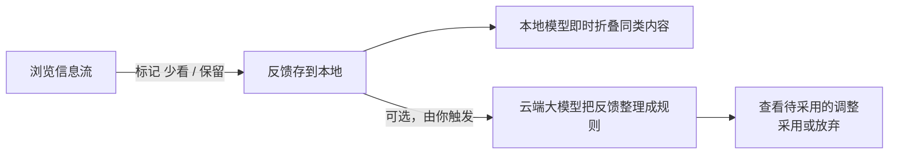

<div align="center">


# 少看一点 · Watch Less

**完全在你浏览器里运行的语义信息流过滤器。**

标记你不想看的内容——一个本地小模型从标记中学习，把同类内容折叠起来。可选的云端整理把你的反馈归纳成有名字的规则。

[](semantic-page-filter.user.js)
[](LICENSE)
[](https://www.tampermonkey.net/)

[English](README.md) · **简体中文**

</div>

---

## 为什么做这个

信息流总会冒出你不想看的东西：标题党、煽动对立、八卦合集。关键词黑名单抓不住"换了说法的同类内容"，而把浏览记录交给云端 AI 过滤，又是一笔你可能不想做的隐私交易。

少看一点走了中间路线：

- 一个**小型多语言语义模型直接跑在你浏览器里**（WebAssembly，约 118 MB，每个网站首次下载一次）。日常过滤不出你的机器。
- 你用**标记**教它，而不是写正则。在卡片旁点两下，同类标题就被折叠。
- 想要更成型的规则时，可以**可选地**把反馈交给云端大模型整理成有名字的规则——每一条变化都等你确认后才生效。不需要自建任何后端。

## 工作方式



1. **正常浏览。** 命中你反馈的内容被折叠成一行占位条，带 **查看** 和 **不该过滤** 按钮——一键恢复，并记为一次保留投票。
2. **标记烦人的内容。** 在任意卡片旁点 **少看类似**，不需要填表。误点？几秒内可撤销，之后也能在面板里纠正。
3. **可选：整理成规则。** 反馈攒够后（默认 10 条），脚本可以请你的大模型把它们归纳成像 *标题党/情绪化标题* 这样带边界的规则。**在你点采用之前，什么都不会变。**

<div align="center">
<table>
<tr>
<td width="40%"></td>
<td width="60%"></td>
</tr>
</table>
<sub>左：主面板——回答原因、管理规则、发起学习。右：命中的卡片原地折叠为占位条。（演示数据；界面为中文。）</sub>
</div>

## 快速开始

**安装** —— 需要 [Tampermonkey](https://www.tampermonkey.net/)。

1. 打开 Tampermonkey → 新建脚本。
2. 把 [`semantic-page-filter.user.js`](semantic-page-filter.user.js) 全文粘贴进去并保存。
3. 打开 B 站首页，点右下角 **少看一点** → **在本站启用**。完成——B 站首页的选择器是内置的。

更新就是同样的"粘贴、保存"；你的反馈、规则和配置单独存储，更新不会丢失。

**接入其他网站** —— 在面板 **设置** 里填写：

| 字段 | 含义 |
| --- | --- |
| 生效地址 | 在哪里生效。`*` 作为协议/域名/路径的通配符；不匹配查询参数。 |
| 条目选择器 | 一张信息流卡片的 CSS 选择器（如 `.bili-video-card`）。别选整个大容器。 |
| 标题选择器 | 卡片内标题的 CSS 选择器。留空则读取卡片文本。 |

保存旁会实时显示匹配数量和首项文字，方便核对。目前没有可视化点选器——这一步仍然动手，网站改版后可能需要调整选择器。

## 日常教学

- **少看类似** —— 记一次"少看"投票，不要求填原因。提示条约 12 秒内可撤销；面板的"最近标记"列表之后也能删除或翻转任意标记，刷新后同样可用。
- **不该过滤** —— 在被过滤的占位条上：恢复这条内容并记为"保留"投票，保护它和同类标题。
- **原因确认卡** —— 当系统猜不出你为什么屏蔽时它会问。勾选候选原因（可多选）、自己写一句、点 **暂不回答** 跳过，或者 **撤销这条少看** 干脆不屏蔽了。你的回答会记在这条反馈上，之后不再重复问。
- **规则** —— 每条已采用的规则都是一张卡片：开关、删除（本地立即生效、可撤销）、用一句话调整。每条规则都能展开查看它依据的反馈样例。

## 云端整理（可选）

默认关闭。你自带任何兼容 Chat Completions 的接口和密钥；学习运行前什么都不会发送——手动点 **立即学习**，或默认攒够 10 条新反馈后自动整理（每日自动次数有上限，默认 1 次，可调——这是防止无人值守计费的保险丝；**立即学习** 不受这两个限制）。

**会发送：** 本轮参与整理的已标记标题（含你补充的原因）、你填写的偏好文字、现有规则的描述与依据。**不会发送：** 你的信息流、未标记的内容、页面正文。

- 整理结果先以"待采用的调整"呈现——**允许自动发送 ≠ 允许自动生效**。已采用的调整可以撤销。
- 内容没变化的批次会去重跳过；失败不自动重试。取消或超时不保证远端已停止执行（或计费）。
- 密钥默认只存在当前标签页内存里——刷新后需重新填写。"记住"会写入油猴存储，方便但不是加密保险箱；停用服务会清除已保存的密钥。

## 如实说明局限

- 本地模型做的是**语义相似匹配**，不是理解：复杂否定、讽刺和反语不可靠。它不读视频内容、图片、`<canvas>`、iframe 或 Shadow DOM。
- 首次使用按网站各下载约 118 MB 模型权重（来自 jsDelivr）；不承诺严格离线启动。
- 长列表/虚拟列表和非 Chromium 浏览器未完整验证。CSP 受限页面会优雅恢复（内容复原并提示）。
- 对泛化效果的宣称刻意保守：本地检查报告的是在你自己样例上的误杀/漏放变化，不代表对新内容的准确率。

<details>
<summary><strong>技术细节</strong></summary>

- 本地推理：Web Worker + 单线程 WebAssembly CPU（`@huggingface/transformers@3.7.2`，从 jsDelivr 加载）。
- 模型：`Xenova/paraphrase-multilingual-MiniLM-L12-v2`，q8 量化，固定 revision `2c4055b12046f11709e9df2c122e59ffbdc2f900`（权重 118,308,126 字节）。
- 存储：油猴存储（`GM_setValue`），按网站配置隔离。配置导出不含密钥。
- 并发锁只协调同一网站的多个标签页——不是全局费用上限。
- `docs/mockup-*.html` 是 README 截图所用的演示数据 mockup。

</details>

## 开发

无构建步骤、无依赖；使用它不需要 Node。

```sh
node --check semantic-page-filter.user.js   # 贡献者的语法检查
```

## 许可

[MIT](LICENSE)。第三方资源（运行库与模型）遵循各自许可，未打包进脚本。
